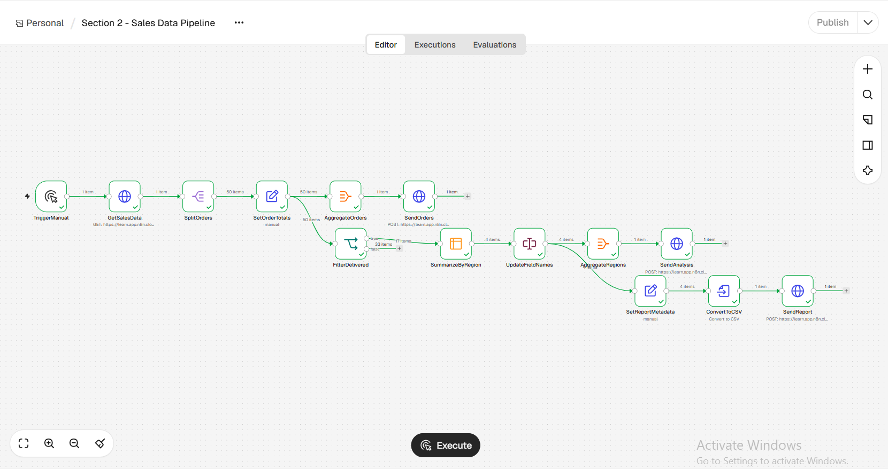

# Sales Data Pipeline Automation | n8n

## Project Overview
An automated sales data processing and reporting workflow developed as part of the n8n Academy Essentials (N8N101) course.

## Key Features
- REST API integration
- Processing 50 sales orders
- Automated order total calculations
- Order filtering by delivery status
- Regional sales analysis
- Sales aggregation and average order value calculations
- CSV report generation
- Automated data submission

## Technologies Used
- n8n
- REST API
- JSON
- CSV
- Data Transformation
- Workflow Automation

## Getting Started
1. Download the workflow JSON file.
2. Import it into n8n.
3. Configure the required API credentials.
4. Execute the workflow manually.

## Project Status
Completed as an n8n Academy educational project.

## Author
## Workflow Screenshot

